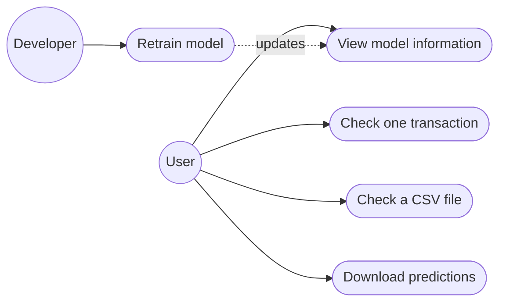
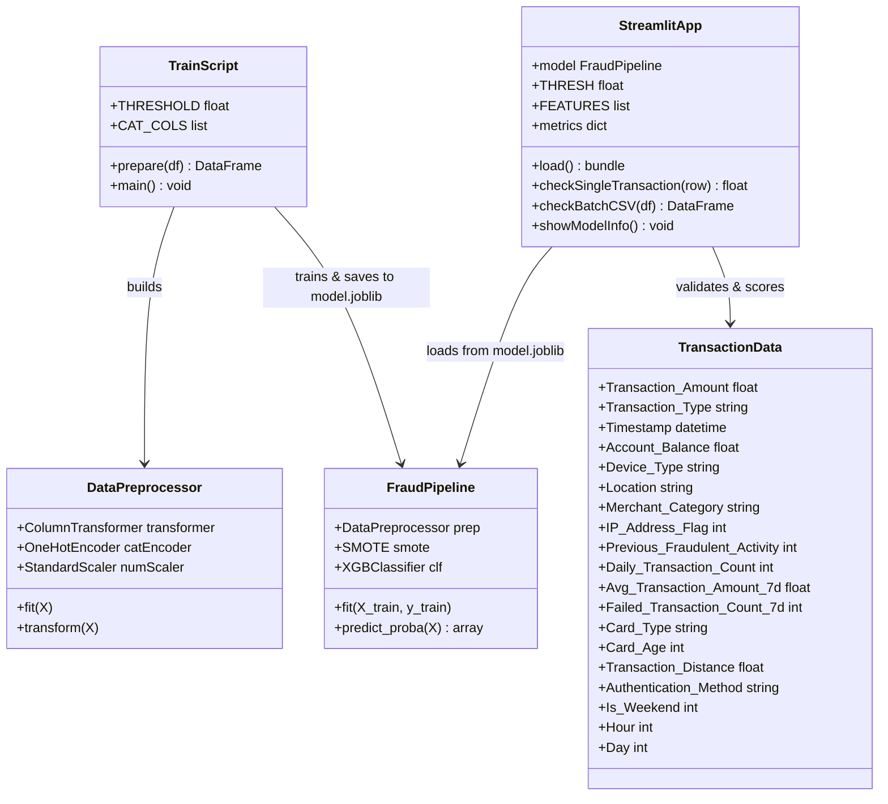
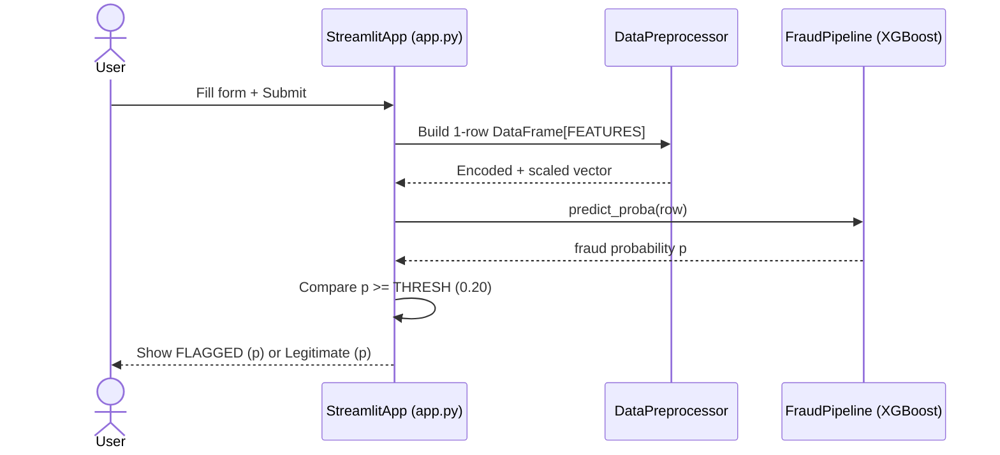
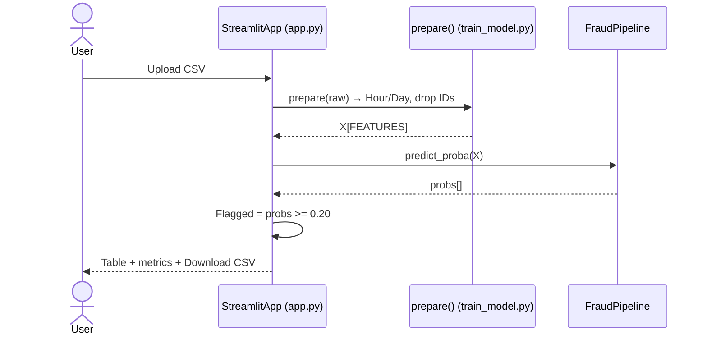
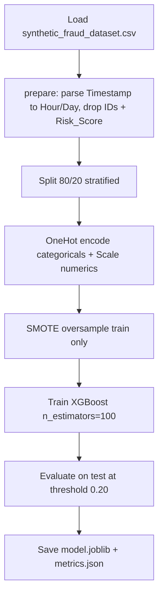

# UML Diagrams — Credit Card Fraud Detection System

Authors: Julianne Benedict Prado, Brylle Garcia

GitHub renders the Mermaid diagrams below automatically.

## 1. Use Case Diagram

## 2. Class Diagram

## 3. Sequence Diagram — Single Transaction Check

## 4. Sequence Diagram — Batch CSV Check

## 5. Activity Diagram — Training

